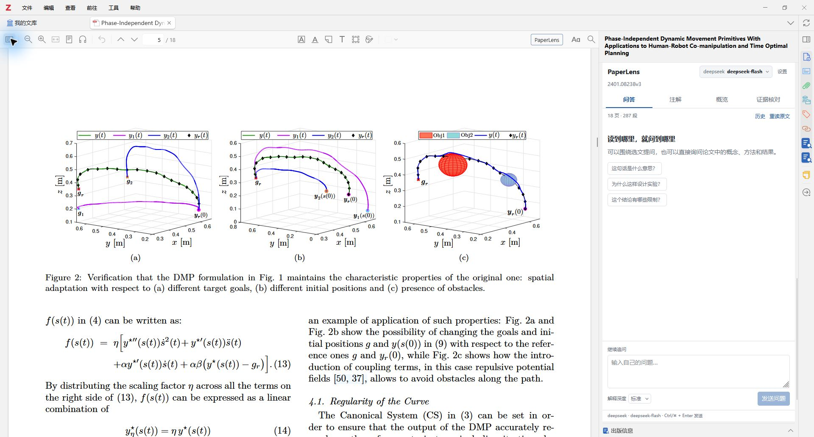
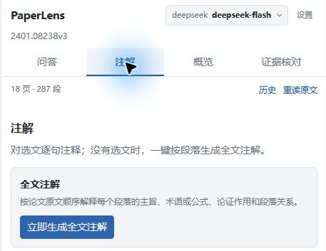
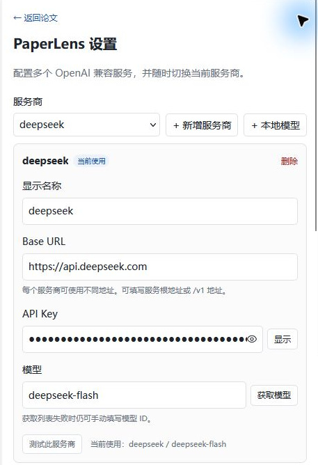
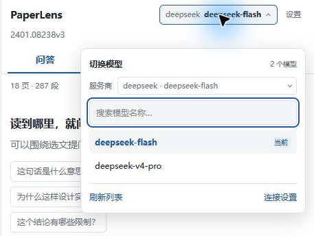
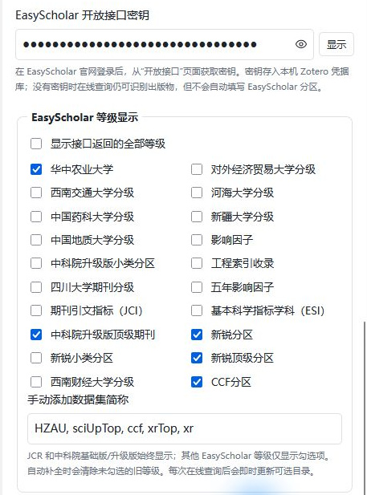
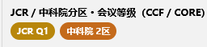
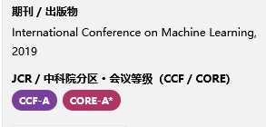
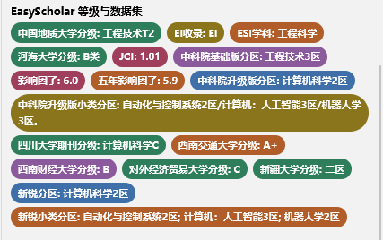

# PaperLens for Zotero

帮助读懂和核对论文的 AI 阅读助手。直接使用 Zotero 的 PDF 阅读器，在常驻侧栏里提问、精读、生成概览和核对论文依据。



正文与阅读任务并排显示，可直接提问，也可切换到注解、概览或证据核对。本文配图均来自原生 Zotero 实机界面，局部图仅裁切到相关区域；配置页中的密钥保持隐藏。截图中的服务商与模型为使用示例，可以替换成自己的 OpenAI 兼容服务、中转站或本地模型。

当前源码版本为 **0.3.14**，支持论文图片框选、上传和粘贴问答，结合图注与正文连续追问；可用 **Alt+A** 或 **Ctrl+Alt+A** 快速框选截图，阅读侧栏采用紧凑布局。正式安装包可从 [Releases](https://github.com/DreamPerday/PaperLens-Zotero/releases/latest) 下载，以发布页标注的版本为准；也可从源码构建。要求 **Zotero 10.0.6–10.x**。已在 Windows 的 Zotero 10.0.7 中验证；macOS、Linux 和其他 Zotero 版本尚未实机验证。

**快速导航：** [安装与开始阅读](#安装与开始阅读) · [AI 服务配置](#ai-服务配置) · [图片问答](#图片问答) · [阅读任务](#阅读任务) · [期刊与分区](#期刊与分区) · [选文翻译浮窗](#选文翻译浮窗) · [数据与隐私](#数据与隐私) · [构建与扩展](#构建与扩展)

## 阅读任务

| 任务 | 用法 |
| --- | --- |
| 问答 | 围绕选文、PDF 框选图片或上传图片提问，也可以直接询问论文；支持连续追问 |
| 注解 | 分析选中文本，或一键按段落生成全文注解，并随正文位置联动 |
| 概览 | 提取研究问题、方法、结果、贡献和局限，长文按全文分段处理 |
| 证据核对 | 输入一个具体主张，对照论文原文判断支持程度、限制和适用条件 |

当前概览基于 Zotero 提取的正文、图注及可提取的表格文字，尚未自动附加图表图像。要分析图中的曲线、结构或视觉细节，可用下方图片问答；仅有图注时，不能据此声称 AI 已查看原图。

全文注解无需逐段选中：在没有选文时切换到 **注解**，点击输入区的 **生成全文注解**，即可按论文原文顺序解释段落主旨、术语或公式、论证作用与段落关系。下图为原生 Zotero 界面截图；新版已将生成入口统一到输入区。



## 安装与开始阅读

1. 打开 [最新发布版本](https://github.com/DreamPerday/PaperLens-Zotero/releases/latest)，在 **Assets** 中下载对应版本的 XPI。从当前源码构建时，文件为 `dist/paperlens-zotero-0.3.14.xpi`。
2. 打开 Zotero → **工具 → 插件**，点击齿轮 → **从文件安装插件**，选择此 XPI。
3. 打开一份本机 PDF，点击阅读器工具栏的 **PaperLens**，或右侧 PaperLens 图标。
4. 在侧栏的 **设置** 中添加服务商，并填写各自的 **显示名称、Base URL、API Key、模型 ID**。可以保存多个服务商；从 Zotero 设置左侧的 **PaperLens** 也可以进入。
5. 选择要测试的服务商，点击 **获取模型** 后选择模型，或手动填写。**测试此服务商** 使用当前表单；测试成功后点击 **保存设置**。
6. 如需自动查询 JCR、中科院分区及 EasyScholar 提供的等级，另外按 [期刊与分区](#期刊与分区) 中的步骤配置 **EasyScholar 开放接口密钥**；AI 服务商的 API Key 不能用于该查询。
7. 在 PDF 中选中句子或段落，点击选文工具中的 **问 PaperLens**，输入自己的问题并发送。

## AI 服务配置

在 PDF 阅读器的 PaperLens 侧栏点击 **设置**，或从 Zotero 设置左侧打开 **PaperLens**。每个服务商单独保存一组连接信息：

| 字段 | 填写内容 | 示例 |
| --- | --- | --- |
| 显示名称 | 自定义名称，便于区分服务 | OpenAI 兼容中转站 |
| Base URL | 服务根地址或 API 版本地址，不要填写密钥、查询参数或完整的聊天接口路径 | `https://api.openai.com/v1`、`https://your-relay.example/v1` |
| API Key | 从对应服务商获取的密钥；本地 Ollama 通常留空 | `sk-...` |
| 模型 ID | 服务商要求的上游模型 ID | `gpt-4o-mini` |

配置界面如下。点击 **新增服务商** 可分别保存不同的地址、密钥与模型；**本地模型** 可快捷添加 Ollama 配置。



点击 **获取模型** 可读取服务端公开的模型列表。如果中转站没有提供模型列表，直接填写该中转站支持的上游模型 ID。点击 **测试此服务商** 后再保存；连接测试使用当前表单内容。可以添加多个服务商，点击 **设为当前** 决定问答、概览、注解和翻译使用哪一个。阅读器顶部的 **模型** 菜单也可以快速切换服务商和模型，不必返回设置页。



本地 Ollama 示例地址为 `http://127.0.0.1:11434/v1`，模型 ID 示例为 `qwen2.5:0.5b`。先在本机安装并运行对应模型；插件不会替用户下载模型。API Key 保存在 Zotero 本机凭据库，截图或共享配置时不要公开真实密钥。

插件直接在 Zotero 内运行，使用原生 PDF 阅读器提取文字。扫描件须先获得可用文字层。

## 图片问答

先在顶部 **模型** 菜单选择支持图片输入的视觉模型；服务商或中转站也须支持 OpenAI 兼容的图片消息。

1. 在 Zotero PDF 阅读器或 PaperLens 输入区按 **Alt+A**，也支持 **Ctrl+Alt+A**，即可打开阅读区并进入框选；在 PDF 页面拖动选出图表或示意图，截图会加入问答草稿。也可从 **问答 → 添加图片（+）→ 框选图片** 进入，窄侧栏中该入口仅显示 **+**。按 Esc 或点击取消可退出；框选不会创建或改动 Zotero 批注。Ctrl+A 保留全选功能。
2. 也可从同一菜单选择 **上传图片**、向输入框粘贴图片或将图片拖入问答区。已有 Zotero 图片批注可从批注标题的 **解读图片** 或右键菜单的 **PaperLens：解读图片** 带入。
3. 图片以缩略图显示，可展开检查、移除。输入“横纵轴分别是什么意思”“这个结构如何对应正文方法”等问题后发送；不输入问题时点击 **解读图片** 可直接生成解释。

每次最多添加 4 张图片，支持 PNG、JPEG、WebP 和 GIF（按静态图片读取）；图片会在本机转为 PNG，最长边不超过 2048 像素。PDF 截图保留页码和区域位置，并优先带入同页图注与相关正文，回答中的图片依据可回跳原图。上传的外部图片不会被标注为论文原图。

连续追问会保留最近一轮图片作为视觉上下文；新增图片后使用新图片。图片请求失败或停止后，图片仍保留在对应问题中，可以切换模型后重试。图片只有在发送或重试时才交给 AI 服务，添加缩略图不会自动请求。

## 期刊与分区

**自动查询 JCR、中科院分区及 EasyScholar 提供的期刊、高校或自定义等级，需要先配置 EasyScholar 开放接口密钥（Key）。此密钥与 AI 服务商的 API Key 分开获取、分别填写。**

1. 注册或登录 [EasyScholar](https://www.easyscholar.cc/)，进入账号的 **开放接口** 页面获取密钥。
2. 打开 Zotero → **设置 → PaperLens**，或阅读器中 PaperLens 侧栏的 **设置**。
3. 将密钥填入 **EasyScholar 开放接口密钥**，点击 **保存设置**。密钥保存在本机 Zotero 凭据库。
4. 根据需要选择显示的等级或数据集；高校等自定义数据集须先在 EasyScholar 账号中启用。JCR 与中科院基础版、升级版固定保留，其他选项按需勾选。
5. 在论文条目中点击 **在线查询出版信息**；新导入的论文也可由自动补全触发查询。

未配置 EasyScholar Key 时，仍可使用 AI 阅读、出版信息匹配和插件内置的 CCF/CORE 会议等级匹配。

下图展示密钥填写位置及关闭 **显示接口返回的全部等级** 后的数据集选项。



选中论文条目后，Zotero **信息** 区会出现 **期刊 / 出版物** 和 **JCR / 中科院分区** 两行。期刊直接写入 Zotero 标准出版字段；会议论文、图书章节和预印本会使用对应出版物字段。

第三条 **CCF / CORE 等级** 展示期刊或会议的 CCF 等级，以及会议的 CORE 等级。分区和等级写入条目标签，例如 `PaperLens/JCR-Q1`、`PaperLens/CAS-2`、`PaperLens/CCF-A`、`PaperLens/CORE-A*`，可以在 Zotero 标签区筛选和同步。编辑时可输入 `Q1`、`中科院 1区`、`CCF-A` 或 `CORE-A*`，留空可清除。标签名称保持纯文字，不添加图案前缀；插件会直接设置 Zotero 标签颜色。

以下配图来自 Zotero 原生界面截图，展示条目详情中的分区和会议等级徽标。





条目侧栏新增 **出版信息** 小节，提供醒目的 **在线查询出版信息** 按钮；也可以在论文条目上右键选择 **PaperLens：在线查询出版信息**。插件会通过 DOI/标题匹配 OpenAlex、Crossref 和 arXiv，先显示论文类型、出版来源、年份和 CCF/CORE 等级，确认后写入条目。EfficientNet 会识别为 ICML 2019、CCF-A、CORE-A*。

文献库主列表也会显示 **期刊 / 出版物、年份、分区 / 会议 / 自定义等级** 三列，直接复用条目标准字段和 PaperLens 标签。JCR、中科院、CCF、CORE 和 EasyScholar 自定义等级在同一列以彩色徽标显示；可以点击列头排序、拖动调整宽度，在列头右键菜单中选择显示或隐藏。内容被截断时悬停可查看完整文本。

**首次导入自动补全默认开启**：导入新的论文条目，或 Zotero 为独立 PDF 识别并创建父条目后，等待元数据稳定约 2 秒，自动查询出版来源、年份和可用等级并填写。批量导入按顺序查询，重复的导入通知不会重复请求。如果第一次没有匹配、出版信息不全或 EasyScholar 返回空等级/暂时出错，会再等 2 秒重试一次；第二次仍为空时保留已获得的有效信息，不编造等级。未获得任何匹配时保留原条目，之后可使用手动查询按钮。

自动补全只添加缺失信息，保留已有出版物、DOI、日期和手动等级。在线匹配指向其他出版版本时，不把该版本等级混入原出版物。插件启动时不会扫描旧文献；编辑已有条目不会触发自动查询。可以在 PaperLens 设置中关闭 **首次导入论文后自动补全出版信息与等级**，无需先配置 AI 模型即可保存此选项。独立 PDF 需要 Zotero 先识别出带标题的论文条目；插件不负责 OCR。

配置 EasyScholar Key 后，插件会合并接口返回的 `officialRank.all` 与 `officialRank.select`。设置为显示全部时，会显示 JCR/SSCI、中科院基础版/升级版/小类、新锐分区/小类、影响因子、JCI、ESI、EI、CCF、四川大学分级、常见高校分级及账号启用的自定义数据集。筛选模式下，JCR 与中科院基础版/升级版始终保留，其它等级（包括 SSCI、CCF 和影响指标）只显示已勾选项。已知等级使用中文名称，未知数据集沿用接口返回的名称。每次查询发现新选项后会合并目录并即时刷新已打开的设置页；详情区支持换行，目录等级列和悬停提示包含已保存的等级。

用户账号启用的 EasyScholar 自定义数据集也会写入条目并在 **出版信息** 中显示彩色徽标；例如数据集中返回 `hzau` 时显示为 **华中农业大学**。插件不内置未经核验的华农分级表，因此需要在 EasyScholar 中启用对应数据集后才能查询到等级。



EasyScholar 的 `rankInfo` 只描述数据集可用档位；实际论文等级必须由 `rank` 中的 UUID 配对确定。若 `rank` 为空，查询确认框会显示“华中农业大学：未匹配”及可选档位，但不会把 A+/A/B/C 中的某一项误写成论文等级。插件在未匹配到自定义数据集等级时会继续尝试去掉年份等后缀后的出版物名称。

EasyScholar 设置中可以关闭“显示接口返回的全部等级”，再勾选需要的分区、指标或数据集；常见选项使用中文名称，未知名称保留接口原名。也可以手动输入 `HZAU`、`UIBE` 等接口简称。筛选结果会用于手动查询和首次导入自动补全；自动补全会保留 JCR、中科院基础版/升级版和已勾选等级，并清除未勾选的旧等级标签。

选择保存后，下一次在线查询只写入并显示选中的数据集；已有条目需要重新执行一次在线查询来清理不需要的旧数据集标签。

CCF 同时支持期刊与会议论文。勾选 CCF 后，在线查询确认的期刊 CCF 等级也会保存在条目标签，并显示在出版信息和目录等级列。手动查询完成后保持当前 PDF 标签页和阅读位置。

侧栏中切换任务、带入选文、改变解释深度或示例问题不会自动生成回答；开启选文自动翻译时，PDF 选文会单独调用翻译。解释深度可选“简明 / 标准 / 深入”；阅读提示可以在设置中关闭。

回答逐步显示，支持 **停止生成** 和失败后的 **重试**。回答支持 GFM Markdown、表格、代码块和 LaTeX 数学公式（行内 `$...$`、独立 `$$...$$`），长公式可以横向滚动。中文标点紧邻加粗标记、AI 在加粗边界误加空格时也可正常显示；代码示例中的 Markdown 与公式分隔符保持原样。停止保留已收到的文字；全文概览和全文注解保留已完成的分段结果，重试会重新执行本次分析。上下文预算是单次原文的字符预算，并不等于模型的总 Token 容量，需为提示词、对话和回答预留空间。

长文概览按顺序处理提取到的全部文字，分段笔记保留摘要、实验设置、表格指标与数值、结论和来源编号。最终汇总接收实际读取的页数及章节记录，并额外复核摘要、实验结果、表格和结论的原文节选，避免把单个片段未包含的章节误报为全文未覆盖。参考文献列表不作为本文实验依据；图片细节或未提取出的表格单元格仍无法仅靠文字读取核对。

点击回答中的页码依据可在 PDF 中定位并临时高亮，**返回阅读位置** 返回跳转前的位置。支持独立 PDF 窗口的嵌入式侧栏，可拖动分隔条调整宽度，收起后从工具栏重新打开。
在“注解”任务中，默认开启“跟随正文”：滚动 PDF、翻页或跳转时，注解区会按当前阅读位置自动滚到对应段落的来源标题并高亮。点击“跟随正文”可暂停，再次点击会恢复并定位当前段落；浏览历史时暂停自动滚动。点击注解来源仍会反向定位正文。联动使用现有注解的来源引用，不额外调用 AI；没有来源引用的旧注解需要重新生成。

侧栏顶部显示紧凑的 **模型** 按钮，点击后可切换服务商、刷新模型列表、搜索模型名称并切换当前模型；窄侧栏优先显示模型名，完整服务商名称在菜单中查看。支持方向键选择、Enter 确认、Esc 关闭。切换后立即保存，不需要进入设置页；Base URL 或 Key 变化仍在 **设置** 中修改。回答生成期间需先停止或等待结束，再切换服务商或模型。菜单采用浮层，展开时不会挤压阅读区，长模型列表可滚动。**历史** 显示本篇全部任务记录。重新发起同一任务的问答、概览或注解时，会移除该任务此前的失败、停止或空白回答及其对应问题，完整历史不受影响。工具栏 **⋯** 菜单提供 **清空阅读记录** 和 **重读原文**：清空前需在侧栏内确认，已保存的 Zotero 笔记保留；重读会重新提取 PDF 文字。替换 PDF 后，旧解读保留，旧引用禁止沿用。

**保存为笔记** 为论文创建 Zotero 子笔记，包含问题、解读、选文、页级来源链接、模型和生成时间。独立附件会创建独立笔记。插件内引用保留区域坐标；普通笔记链接提供页级回跳，不会为每条 AI 引用创建原生高亮。

## 选文翻译浮窗

配置 AI 后，在 PDF 中选中句子或段落，停留约半秒即可自动显示简体中文译文。翻译不需要打开侧栏或输入问题；请求只包含当前选文，不会读取整篇论文作为翻译上下文，也不会写入问答历史。

选区是单个英文单词时，默认优先查询内置的离线英汉词典。词典命中后直接显示中文释义，不发起网络或模型请求；内置词典收录约 5.8 万条常见、考试和较高频词条，并支持常见复数、过去式和进行时的词形还原。

离线词典未命中时，可以在设置中指定专用的 **单词翻译服务商**，建议使用本机 Ollama/LM Studio 的小模型。单词请求使用更短的词典提示词，只访问该专用服务，不调用当前远程服务商，因此不会消耗远程 Token。短语、句子和段落仍使用当前服务商。设置中也可以通过 **本地模型** 快捷添加默认的 Ollama 地址 `http://127.0.0.1:11434/v1` 和 `qwen2.5:0.5b` 示例，模型需要用户自行安装。

浮窗支持流式译文、Markdown 与数学公式、展开原文、复制、停止和重试。拖动标题栏可移动浮窗，长译文在窗内滚动。点击关闭、按 Esc、重新选择其他原文、追问或关闭阅读器时收起浮窗。设置中的 **点击浮窗外或滚动 PDF 时保持译文打开** 默认开启，方便边看原文边读译文；关闭后会恢复为点击其他区域或滚动页面时自动收起。未完成的翻译会在明确关闭或更换选文时取消。

在浮窗底部或 PaperLens 设置中关闭 **选中后自动翻译**，此后选文不再自动请求模型，需要时点击原生选文工具栏的 **翻译**。点击 **在侧栏追问** 会将同一选文带入问答，用户输入问题后才发起问答请求。

## 数据与隐私

- 每个服务商的 AI Key 分别使用 Zotero 所在环境的 Mozilla 凭据存储 `Services.logins`，不写入普通配置、笔记或 XPI。
- 服务商列表、显示名称、服务地址、模型、当前服务商、单词翻译服务商、深度、上下文预算和自动翻译偏好保存在 `extensions.paperlens.settings` 偏好中。
- 期刊写入条目标准出版字段；分区写入条目标签，并遵循 Zotero 自身的数据同步规则。
- 离线词典随 XPI 本地提供，词条查询不会上传选中的单词。
- 原文索引及阅读记录（包括待发送和历史问题中的图片）存放在 **Zotero 数据目录下的 `paperlens/`**，按 `libraryID_attachmentKey` 区分附件，使用 JSON 保存。
- 论文问答、精读等主动操作会向用户配置的服务发送相关原文及近期对话；开启自动翻译时，选中 PDF 文字会将选文发送到同一服务。模型发现和连接测试同样会访问配置的服务。
- 图片问答会向当前服务发送添加的图片及相关论文文字；继续追问时也会发送最近一轮图片。图片保存在本机阅读记录，保存为 Zotero 笔记时记录图片名称及可用的 PDF 来源链接。
- 使用手动在线出版查询或开启首次导入自动补全时，会将论文标题或 DOI 发送到 OpenAlex、Crossref 或 arXiv；CCF/CORE 匹配使用插件内置的 CCFDDL 精简榜单，不额外上传论文内容。自动查询仅针对插件启用后新导入的论文，可在设置中关闭。
- 配置 EasyScholar 密钥后，查询还会将论文的期刊或会议名称发送给 EasyScholar 开放接口，以获取等级数据。
- 阅读历史只在本机保存。主动保存的 Zotero 笔记遵循用户的 Zotero 同步设置；卸载插件会保留本机阅读记录和笔记。
- 插件没有账号、租户体系、遥测或后台资料库批量上传。

## 当前边界

问答可分析手动添加的图片，读图能力取决于所选视觉模型、图片清晰度和截取范围；全文概览与全文注解仍以 Zotero 提取出的文字、可提取公式文本和图注为依据。当前不做扫描件全文 OCR、联网事实查证、跨论文比较或底层模型训练；公式在回答中使用 KaTeX 排版，输入 PDF 的公式提取质量仍取决于 Zotero。

注解有选文时以当前选文为单位，没有选文时按原文分段处理整篇论文；长文按上下文预算分批生成并保留段落来源。段落关联使用邻近段落与关键词相关原文，复杂排版的提取质量仍取决于 Zotero。跨页段落保存多个位置，块引用默认定位到首个片段。证据核对中的“当前依据不足”表示本文范围内证据不够，不等于主张错误。

插件通过本仓库的 `updates.json` 检查新版本，也可以从 [Releases](https://github.com/DreamPerday/PaperLens-Zotero/releases) 下载 XPI 手动更新。从独立仓库发布前的本机开发版迁移时，请手动安装一次本仓库的 XPI，以切换到新的更新地址。插件 ID 保持不变，本机设置和阅读记录可继续使用。

## 构建与扩展

安装 Git 和 Node.js 20 或更新版本，克隆独立插件仓库后运行：

```powershell
git clone https://github.com/DreamPerday/PaperLens-Zotero.git
cd PaperLens-Zotero
npm ci
npm run check
npm test
npm run build
```

构建只打包 `addon/` 与编译后的运行资源，当前产物为 `dist/paperlens-zotero-0.3.14.xpi`。KaTeX 样式、字体、精简离线词典和 CCF/CORE 榜单随安装包提供，界面脚本与样式使用版本化文件名，避免升级后沿用旧样式。开发脚本、测试库、凭据和阅读数据均不进入 XPI。

| 文件 | 负责的能力 |
| --- | --- |
| `src/host.ts` | 原生入口、侧栏、独立窗口、设置页及生命周期 |
| `src/zotero-adapter.ts` | SDT 文本提取、坐标跳转、笔记与附件身份 |
| `src/reading/position.ts` | 将 PDF 阅读视口匹配到原文块，驱动正文与注解联动 |
| `src/reading/normalize.ts` | Zotero 结构化文本到可引用原文块 |
| `src/reading/context.ts` | 上下文选取、四种任务提示词、长文分段 |
| `src/ai/client.ts` | 兼容 API、模型列表、流式响应和停止 |
| `src/controller.ts` | 任务、历史、停止重试与来源关联 |
| `src/history.ts` | 新请求替换同任务失败或中断的旧回答 |
| `src/paper-metadata.ts` | 期刊标准字段、JCR/中科院分区标签 |
| `src/paper-online.ts` | OpenAlex、Crossref、arXiv 出版信息查询与确认写入 |
| `src/publication-columns.ts` | 文献库出版物、年份和等级列及彩色徽标 |
| `src/publication-import.ts` | 新导入论文的自动补全、去重队列与一次重试 |
| `src/paper-ranks/ccf.json` | 由 CCFDDL 生成的 CCF/CORE 会议等级索引 |
| `src/translation/` | 选文翻译请求、浮窗定位、拖动与生命周期 |
| `src/translation/dictionary.json` | 由 ECDICT 生成的精简离线英汉词库 |
| `src/settings.ts` | 多服务商设置、旧配置迁移和当前服务商选择 |
| `src/storage.ts` | 多服务商凭据、本地索引与历史 |
| `src/ui/` | 侧栏内容和交互 |

后续优先扩展图表按需理解、原文查找、可选 OCR 和跨论文核对。新增能力应先接入同一套附件身份、原文位置与明确触发动作，避免增加第二套文献管理界面。

## 隔离开发与验证

本地测试可使用独立 Zotero 配置和合成 PDF，不连接个人资料库。下列命令从仓库根目录运行；先完成 `npm ci` 和 `npm run build`，Python 仅用于生成测试材料：

```powershell
python -m pip install reportlab
python scripts/create-fixtures.py
node scripts/dev-profile.mjs --launch --zotero "C:\Program Files\Zotero\zotero.exe"
```

`--zotero` 改为本机程序路径。脚本在仓库 `output/zotero-dev/` 建立独立 profile 和 data，关闭同步与自动更新；本地调试端口为 6101，测试插件通过本地文件桥接执行检查。仅用于隔离开发，不要将此 profile 或开发测试插件安装到个人配置。已运行时先关闭测试 Zotero，再重新执行启动命令。

另开终端运行本地模拟 AI 服务，再执行原生检查：

```powershell
node scripts/mock-relay.mjs
# 在另一终端中运行：
node scripts/command.mjs scripts/native-smoke.js
node scripts/command.mjs scripts/ui-smoke.js
node scripts/command.mjs scripts/annotation-smoke.js
node scripts/command.mjs scripts/resize-smoke.js
node scripts/command.mjs scripts/history-smoke.js
node scripts/command.mjs scripts/metadata-smoke.js
node scripts/command.mjs scripts/online-smoke.js
node scripts/command.mjs scripts/translation-smoke.js
node scripts/command.mjs scripts/translation-drag-smoke.js
node scripts/command.mjs scripts/translation-window-smoke.js
```

离线词典可通过 `python scripts/build-dictionary.py` 从 MIT 许可的 ECDICT 数据重新生成；来源和许可证说明见 `src/translation/OFFLINE_DICTIONARY.md`。
会议等级数据可通过 `python scripts/build-ccf.py` 从 MIT 许可的 CCFDDL 公开目录重新生成；来源说明随 XPI 提供在 `content/CCF_DATA.txt`。

验证不重启升级时，先在隔离 profile 中运行旧版本并执行一次原生检查，再构建新版本，运行 `node scripts/command.mjs scripts/upgrade-smoke.js`；它会安装仓库当前版本并检查新版脚本与样式是否生效。

当前验收范围见 [验收记录](verification.md)。模拟服务验证功能流程，不能证明真实模型的论文理解质量。

## 发布维护

版本号分别位于 `package.json` 和 `addon/manifest.json`。发布时同时更新这两处与锁文件，运行上述检查及构建，将 XPI 上传至对应版本的 GitHub Release，再更新 `updates.json` 的版本、兼容范围与 `update_link`。已发布标签和安装包应保持不变，后续修订发布为新版本。

GitHub Actions 会在推送和拉取请求中执行类型检查、单元测试和构建，并保留 XPI 构建产物。普通用户从 Releases 下载正式安装包即可。

## 开源许可证

PaperLens for Zotero 采用 [MIT 许可证](LICENSE)，版权归 DreamPerday 所有。允许使用、修改、分发和商用，分发时需保留版权声明和许可证文本；软件按原样提供，不作担保。

第三方依赖及其字体、样式等资源遵循各自的许可证。
